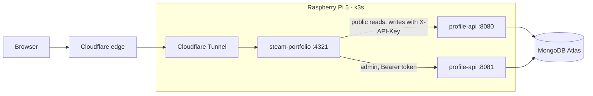

# AGENTS.md - Steam Profile Portfolio

Instructions for coding agents working in this repository. Read this whole file before making changes.

## 1. What this project is

A personal developer portfolio for **Adlee Afif** (Backend Engineer, Malaysia) styled after a **Steam Community profile**. Every Steam profile feature maps to a piece of career data:

| Steam feature    | Portfolio meaning                        |
| ---------------- | ---------------------------------------- |
| Level            | Years of professional experience         |
| Online status    | Available / Working / Sleeping / Holiday |
| Badges           | Certificates                             |
| Inventory        | Skills, with a tab per company           |
| Games library    | Projects                                 |
| Achievements     | Career milestones                        |
| Recent activity  | GitHub activity                          |
| Friends / Groups | Socials / Communities and education      |
| Comments         | Guestbook                                |
| Wishlist         | Learning roadmap                         |

This repo is the **frontend only**. All data comes from **profile-api** (`C:\Workspace\profile-api`), a shared Go service backed by MongoDB Atlas. Read that repo's `AGENTS.md` and `api/openapi.yaml` before touching data code. This app never connects to MongoDB.

Both run on a **Raspberry Pi 5 (8 GB, SD card) with k3s**, exposed through a **Cloudflare Tunnel**.

Predecessor project (visual reference only, do not modify): `C:\Workspace\linux-portfolio`.

## 2. Tech stack (fixed - do not substitute)

- **Astro 5** with `output: "server"` and the **`@astrojs/node`** adapter in `standalone` mode.
- **TypeScript** strict (`astro/tsconfigs/strict`).
- **Tailwind CSS** (whichever integration the current Astro docs recommend).
- **React islands** (`@astrojs/react`) only for interactive parts. Everything else is `.astro` with zero client JS.
- **API client**: types generated from profile-api's OpenAPI spec with `openapi-typescript`, and requests made with `openapi-fetch`.
- **Container**: multi-arch image (`linux/arm64` required), deployed to k3s with manifests in `k8s/`.
- Package manager **npm**, Node **20 LTS** or newer.

Pi constraints:

- Target under 200 MB for the container.
- No writes to local disk at runtime.
- Log to stdout only.

## 3. How data flows



- **Pages**: Astro server code calls profile-api over cluster DNS (`PROFILE_API_URL`), renders HTML and returns it. Islands receive data as props and do not fetch on load.
- **Status refresh**: the status island polls this app's `/api/status.json` every 60s. That route proxies `GET /v1/status`.
- **Contact and guestbook**: the browser POSTs to this app's `/api/contact` and `/api/comments`. Those routes forward to `POST /v1/apps/steam-portfolio/{messages|comments}` with:
  - `X-API-Key: PROFILE_API_KEY`
  - `X-Client-IP` set from `CF-Connecting-IP`

  The API key never reaches the browser.

- **Admin**: `/admin` pages call the admin listener (`PROFILE_API_ADMIN_URL`) server-side with the session token stored in an HTTP-only cookie.
- **Caching**: profile-api already caches reads, so this app has no data cache of its own. Public pages send `Cache-Control: public, max-age=0, s-maxage=60, stale-while-revalidate=300` for the Cloudflare edge. Admin pages, `/api/*` and any response that sets a cookie send `private, no-store`.
- **Failure**: if profile-api is unreachable or returns 5xx, render the page shell with a Steam-style "Unable to load" panel for that section. Never return a raw 500 for a public page.

## 4. Commands

```bash
npm install
npm run dev            # http://localhost:4321
npm run build
npm run preview        # node ./dist/server/entry.mjs
npm run check          # astro check - must pass
npm run lint           # eslint - must pass
npm test               # vitest
npm run gen:api        # openapi-typescript ../profile-api/api/openapi.yaml -o src/lib/api/schema.d.ts
docker buildx build --platform linux/arm64,linux/amd64 -t <registry>/steam-portfolio:<tag> --push .
kubectl apply -k k8s/
```

For local development, run profile-api locally (`make run` in that repo) and point `PROFILE_API_URL` at `http://localhost:8080` and `PROFILE_API_ADMIN_URL` at `http://localhost:8081`.

Definition of done for any change:

- `npm run check`, `npm run lint` and `npm run build` pass.
- `src/lib/api/schema.d.ts` is regenerated after API changes.
- The affected page renders against a locally running, seeded profile-api.

## 5. Environment variables

| Variable                | Required | Purpose                                                                                     |
| ----------------------- | -------- | ------------------------------------------------------------------------------------------- |
| `PROFILE_API_URL`       | yes      | e.g. `http://profile-api.profile-api.svc.cluster.local:8080`                                |
| `PROFILE_API_ADMIN_URL` | yes      | e.g. `http://profile-api-admin.profile-api.svc.cluster.local:8081`                          |
| `PROFILE_API_KEY`       | yes      | Server key for client app `steam-portfolio` (printed by profile-api's seed or key rotation) |
| `PROFILE_API_APP`       | no       | Default `steam-portfolio`                                                                   |
| `SITE_URL`              | yes      | Public URL for canonical links and the CSRF `Origin` check                                  |
| `TRUST_CF_HEADERS`      | no       | `true` in production. Read the client IP from `CF-Connecting-IP`                            |
| `PUBLIC_GA_ID`          | no       | Google Analytics 4. Skip GA when unset                                                      |

In k3s these come from secret `steam-portfolio-env`. Commit only `k8s/secret.example.yaml`.

## 6. Project structure

```
src/
  pages/
    index.astro                 # Profile
    badges/index.astro
    badges/[id].astro
    inventory.astro
    games/index.astro
    games/[slug].astro
    achievements.astro
    wishlist.astro
    replay.astro
    store.astro                 # "Hire Me"
    shop.astro                  # Points Shop
    admin/                      # login, dashboard, one page per collection, inbox, moderation
    api/
      status.json.ts            # proxy GET /v1/status
      contact.ts                # forward to /v1/apps/{app}/messages
      comments.ts               # GET approved / POST forward to /v1/apps/{app}/comments
      admin/[...path].ts        # authenticated proxy for admin island actions
      health.ts                 # liveness for k8s
  layouts/
    BaseLayout.astro            # Steam client chrome + Deck nav
    AdminLayout.astro
  components/
  islands/
  lib/
    api/
      schema.d.ts               # generated, do not edit
      public.ts                 # typed client for :8080
      admin.ts                  # typed client for :8081, takes the session token
    presentation/
      level.ts                  # ring colour by level
      status.ts                 # labels and colours per status kind
      rarity.ts                 # tier names and colours
    session.ts                  # cookie read/write for the admin token
  middleware.ts                 # /admin guard, CSRF Origin check on mutating requests
  styles/global.css
k8s/
  kustomization.yaml
  namespace.yaml                # label profile-api/admin-client: "true"
  deployment.yaml
  service.yaml
  secret.example.yaml
Dockerfile
```

The shared `cloudflared` deployment lives in profile-api's `deploy/cluster`, not here.

## 7. Presentation rules (`src/lib/presentation`)

The API returns raw values (`level`, `status.kind`, skill `tier`). Labels and colours are decided here.

- **Level ring colour** changes every 10 levels. The index is `floor(level / 10) % 10`:

  | Index | Colour    |
  | ----- | --------- |
  | 0     | `#9b9b9b` |
  | 1     | `#c02942` |
  | 2     | `#d95b43` |
  | 3     | `#fecc23` |
  | 4     | `#467a3c` |
  | 5     | `#4e8ddb` |
  | 6     | `#7652c9` |
  | 7     | `#c252c9` |
  | 8     | `#542437` |
  | 9     | `#997c52` |

  The XP bar uses `level.progress`. When `level.isAnniversary` is true, show a one-time "LEVEL UP" animation, remembered in localStorage.

- **Status**:

  | kind      | Label   | Colour    | Extra line                                                       |
  | --------- | ------- | --------- | ---------------------------------------------------------------- |
  | available | Online  | `#57cbde` | "Open to chat"                                                   |
  | working   | In-Game | `#90ba3c` | "Currently playing: {currentRole.title} @ {currentRole.company}" |
  | sleeping  | Snooze  | `#4b8c9b` | Local time (`localTime`)                                         |
  | holiday   | Away    | `#898989` | "On holiday" (until `overrideUntil` when set)                    |

- **Rarity (skill tier)**:

  | Tier | Name             | Colour    | Proficiency  |
  | ---- | ---------------- | --------- | ------------ |
  | 1    | Consumer Grade   | `#b0c3d9` | Familiar     |
  | 2    | Industrial Grade | `#5e98d9` | Beginner     |
  | 3    | Mil-Spec         | `#4b69ff` | Intermediate |
  | 4    | Restricted       | `#8847ff` | Proficient   |
  | 5    | Classified       | `#d32ce6` | Advanced     |
  | 6    | Covert           | `#eb4b4b` | Expert       |

## 8. Pages and features

Visual language:

- Steam colours: background `#1b2838`, header `#171a21`, panels `rgba(0,0,0,0.3)`, accent `#66c0f4`, text `#c7d5e0`, muted `#8f98a0`.
- Steam button styles: blue-translucent and green gradient.
- Content is a centred 976px column.
- The footer says the site is not affiliated with Valve. Use no Valve logos or assets.

Pages:

- **Base layout**: Steam client top bar with STORE (`/store`), LIBRARY (`/games`), COMMUNITY (`/achievements`) and PROFILE (`/`, with a dropdown for Badges, Inventory, Games, Achievements, Wishlist, Replay, Points Shop). On mobile, a bottom tab bar replaces it ("Steam Deck mode"): Profile, Library, Inventory, Badges, Store.
- **Profile (`/`)**, from `GET /v1/profile` plus the other list endpoints, fetched in parallel:
  - **Header**: avatar with the selected frame, persona name, country flag (`https://flagcdn.com/24x18/{cc}.png`), real name, location, summary, Level card (ring, XP bar, "N XP to Level N+1"), featured badge, and "Message" / "Download Resume" buttons.
  - **Left column** showcases: Favorite Game, Item Showcase (`showcaseSkillIds`), Rarest Achievement (lowest `globalPercent` among unlocked), Review Showcase, Workshop Showcase, Recent Activity (`/v1/activity`, labelled as an estimate), Comments, and the contact form.
  - **Right column**: status panel, counts linking to each page, Groups, Friends.
- **Badges (`/badges`, `/badges/[id]`)**: certificate grid with issuer, date, XP and `totalXp`. The detail page shows related skills (linked to the inventory) and a "Verify" button. The page also shows the trading card collection.
- **Inventory (`/inventory`)** (island), using `/v1/skills` and `/v1/companies`:
  - Tabs: "All" plus one per company, in `order`.
  - Search and a category filter.
  - Item grid with a rarity-coloured bottom border and a simpleicons image (`https://cdn.simpleicons.org/{slug}/{color?}`), or a text fallback.
  - Clicking an item opens a side panel with rarity, proficiency, years used, description, companies and projects.
  - Tab and item are kept in `?tab=&item=`.
- **Games (`/games`, `/games/[slug]`)**:
  - The library shows hours played, `lastPlayed` and achievement progress.
  - The detail page is store-style: banner, description, tags, "Play" and "View Source" buttons, and achievements.
- **Achievements (`/achievements`)**: unlocked first, then locked (greyed out), with "X% of players", an overall progress bar, and a hidden Konami-code achievement (client-side, localStorage).
- **Wishlist (`/wishlist`)**: target "release date" and a progress bar.
- **Replay (`/replay`)**: from `/v1/replay`, with a year selector (`?year=`).
- **Store (`/store`)**: a "Hire Me" page.
  - "Add to Cart" downloads the resume.
  - "Add to Wishlist" opens the contact form.
  - System requirements show the stack, and the review score comes from reviews.
- **Points Shop (`/shop`)** (island): CSS backgrounds and avatar frames. Everything is free, and the choice is saved in localStorage.
- **Contact and guestbook**:
  - Forms include the honeypot field `website`.
  - Show Steam-style toasts on success.
  - On 429, show the "slow down" message returned by the API.
  - Guestbook comments only appear after approval.
- **Easter eggs** (client-side, localStorage):
  - an "Adlee is now Online" toast once per session
  - the Konami achievement
  - trading card drops: 25% chance per navigation, 6 cards, and collecting all of them crafts a bonus badge on `/badges`

## 9. Admin UI (`/admin`)

- **Login** posts to `POST /v1/admin/login` server-side. Store the returned token in an HTTP-only, `Secure`, `SameSite=Strict` cookie that expires at `expiresAt`. Logout calls `POST /v1/admin/logout` and clears the cookie.
- **Access control**:
  - Middleware redirects to the login page when the cookie is missing, or when the API answers 401.
  - Every mutating request must pass an `Origin` check against `SITE_URL`.
  - In production, `/admin*` and `/api/admin*` are also behind Cloudflare Access (owner's email only).
- **Dashboard**:
  - A status quick switch at the top (Auto / Available / Working / Sleeping / Holiday, optional "until") calls `PUT /v1/admin/status`.
  - Counts of unread messages and pending comments come from `GET /v1/admin/summary`.
- **Collections**: a list and edit form for each collection (profile, companies, skills, certificates, projects, achievements, friends, groups, reviews, workshop, wishlist, clients), with reordering via `/reorder`.
- **Inbox and moderation**: an inbox for messages and moderation for comments. Both are scoped to `PROFILE_API_APP`, with an app switcher for other client apps.
- **Validation**: show validation errors from the API's `error.details` next to the matching form fields.

## 10. Deployment

- **Image**: multi-stage `Dockerfile` (`node:20-alpine`).
  - The runtime stage has only `dist/` and production dependencies, and runs as non-root.
  - Environment: `HOST=0.0.0.0`, `PORT=4321`, `NODE_OPTIONS=--max-old-space-size=160`.
- **`k8s/`** (namespace `steam-portfolio`, labelled `profile-api/admin-client: "true"` so profile-api's NetworkPolicy allows admin traffic):
  - **Deployment**: 1 replica.
    - Resources: requests `cpu: 50m, memory: 96Mi`, limit `memory: 256Mi`.
    - Probes on `/api/health`.
    - `securityContext`: `runAsNonRoot`, `readOnlyRootFilesystem`, all capabilities dropped.
    - `envFrom` secret `steam-portfolio-env`.
  - **Service**: `ClusterIP` on port 4321.
  - No Ingress. Traefik is not used.
- **Cloudflare**:
  - The shared tunnel (profile-api `deploy/cluster`) routes `<portfolio-domain>` to `http://steam-portfolio.steam-portfolio.svc.cluster.local:4321`.
  - Add a Cache Rule that caches HTML while respecting origin headers and bypasses `/admin*` and `/api/*`.
  - Add an Access application on `/admin*` and `/api/admin*`.

## 11. Conventions

- Only `src/lib/api/*` calls profile-api. Pages and components call those helpers.
- No hard-coded career content in components.
- Ship no client JS unless needed. Prefer `client:visible` or `client:idle`.
- Accessibility:
  - Tabs and dialogs work with the keyboard.
  - Every image has `alt` text.
  - Colour is never the only signal; rarity and status also show their names.
- Keep comments rare. Only explain constraints the code cannot show.
- Conventional Commits.

## 12. Build order

Start this after profile-api reaches phase 4 (public read endpoints and OpenAPI). Each phase should leave the app building.

1. Scaffold Astro (server output, Node adapter, TS strict, Tailwind, React), `.env.example`, generated API types, and `src/lib/api`.
2. Presentation helpers with Vitest tests. Base layout (Steam chrome + Deck nav).
3. Profile header and the `/api/status.json` proxy.
4. Badges.
5. Inventory island.
6. Games.
7. Achievements, showcases, activity, friends and groups.
8. Admin login, dashboard status switch, and collection editors (needs profile-api phase 6).
9. Contact and guestbook forwarding with moderation pages (needs profile-api phase 7).
10. Wishlist, Replay, Store, Points Shop, easter eggs, and GA4.
11. ARM64 Dockerfile and `k8s/` manifests.
