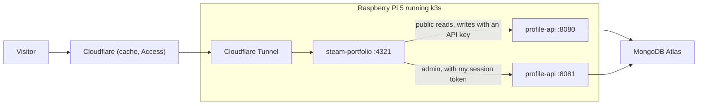

# steam-profile-portfolio

My developer portfolio, styled after a Steam Community profile. Instead of a CV page, my career is laid out the way Steam shows a player:

| On Steam         | Here                                          |
| ---------------- | --------------------------------------------- |
| Level            | Years of professional experience              |
| Online status    | Available, working, sleeping or on holiday    |
| Badges           | Certificates                                  |
| Inventory        | Skills, with a tab for each company           |
| Games library    | Projects, with hours played                   |
| Achievements     | Career milestones                             |
| Recent activity  | My GitHub activity                            |
| Friends / Groups | Socials, communities and education            |
| Comments         | A guestbook                                   |
| Wishlist         | Things I'm learning next                      |
| Store page       | "Hire Me", where Add to Cart downloads my CV  |

It is not affiliated with Valve and uses no Valve logos or assets.

The site holds no career data of its own. Everything comes from [profile-api](../profile-api), a small Go service that stores my career in MongoDB Atlas and is shared by any site I build. Both run on a Raspberry Pi 5 at home, reachable only through a Cloudflare Tunnel.

## How it fits together



The site is built with [Astro](https://astro.build) and renders every page on the server:

1. A visitor asks for a page.
2. The server fetches what the page needs from profile-api over the cluster network, in parallel.
3. It renders plain HTML and sends it back. Most pages ship no JavaScript at all.
4. Cloudflare caches the HTML for a minute, so most visitors never reach the Pi.

Only the interactive parts are React "islands" that load in the browser: the live status, the inventory, the forms, the Points Shop and a few easter eggs. They receive their data from the server and don't fetch it again on load.

### When profile-api is down

Each section of a page loads independently. If one fails, that section shows a Steam-style "Unable to load" panel and the rest of the page still works. A public page never shows a raw error. A page that had a failure is sent with `no-store`, so Cloudflare doesn't keep serving the broken version once the API is back.

### Live status

The status panel asks the site's `/api/status.json` every minute (and pauses while the tab is hidden). That route asks profile-api, which works out whether I'm working, sleeping or available from my time zone and schedule.

### Guestbook and contact form

The browser posts to the site's own `/api/comments` and `/api/contact`. The server forwards them to profile-api with:

- a server API key, which never reaches the browser
- the visitor's real IP from Cloudflare's `CF-Connecting-IP`, so profile-api's limit of 5 posts per hour per visitor works

A hidden honeypot field catches bots. Comments only appear after I approve them.

### Admin

`/admin` is my dashboard for editing everything on the site. It talks to profile-api's admin port, which is never exposed to the internet.

- Logging in stores the session token in an HTTP-only, `Secure`, `SameSite=Strict` cookie.
- Every form post must come from the site's own origin.
- In production the whole of `/admin` is also behind Cloudflare Access, limited to my email.

From the dashboard I can:

- switch my status (Auto, Available, Working, Sleeping, Holiday, optionally until a given time)
- see unread messages and pending comments
- edit the profile and every collection, reorder them, and rotate a site's API key
- read messages and approve comments

Validation errors from the API appear next to the field they belong to.

### Just for fun

All of these live only in the visitor's browser (localStorage):

- **Points Shop** (`/shop`): free profile backgrounds and avatar frames.
- **Trading cards**: each page view has a 25% chance to drop one of 6 cards. Collect them all to craft a bonus badge on `/badges`.
- **Konami code**: unlocks a hidden achievement.
- **"adlee is now Online"**: a toast once per visit.
- **Level up**: a one-time animation on my work anniversary.

## Running it locally

You need Node 20 or newer, and a running profile-api.

1. Start profile-api (see its README). For a throwaway local database:

   ```bash
   docker run -d --name spp-mongo -p 27017:27017 mongo:7
   ```

   Then set `MONGODB_URI=mongodb://localhost:27017` in profile-api's `.env`, run `make seed` and `make run`. The seed prints the steam-portfolio API key once.

2. Set up this site:

   ```bash
   npm install
   cp .env.example .env   # paste the API key into PROFILE_API_KEY
   npm run dev            # http://localhost:4321
   ```

### Settings

| Variable                | Required | Purpose                                                       |
| ----------------------- | -------- | ------------------------------------------------------------- |
| `PROFILE_API_URL`       | yes      | profile-api's public port, e.g. `http://localhost:8080`       |
| `PROFILE_API_ADMIN_URL` | yes      | profile-api's admin port, e.g. `http://localhost:8081`        |
| `PROFILE_API_KEY`       | yes      | Server API key for the `steam-portfolio` client               |
| `PROFILE_API_APP`       | no       | Client app id. Default `steam-portfolio`                      |
| `SITE_URL`              | yes      | Public URL, used for canonical links and the origin check     |
| `TRUST_CF_HEADERS`      | no       | `true` in production, to read the visitor IP from Cloudflare  |
| `PUBLIC_GA_ID`          | no       | Google Analytics 4. Analytics are off when unset              |

They are read when the server starts, not baked into the build, so one image works everywhere.

### Commands

```bash
npm run dev       # development server
npm run check     # type check
npm run lint      # eslint
npm test          # unit tests (vitest)
npm run build     # production build
npm run preview   # run the production build
npm run gen:api   # regenerate API types from ../profile-api/api/openapi.yaml
```

## Deploying

The image is built for both `linux/arm64` (the Pi) and `linux/amd64`:

```bash
docker buildx build --platform linux/arm64,linux/amd64 -t <registry>/steam-portfolio:<tag> --push .
```

It contains only the built site, the few packages the server actually loads, and the Node binary on plain Alpine. That comes to about 140 MB, and it uses around 30 MB of memory when idle. It runs as a non-root user with a read-only filesystem and logs to stdout.

To deploy to k3s:

1. Copy `k8s/secret.example.yaml` to `k8s/secret.yaml` (gitignored), fill it in, and `kubectl apply -f k8s/secret.yaml`.
2. Set the image registry and tag in `k8s/kustomization.yaml`.
3. Run `kubectl apply -k k8s/`.

The namespace carries the `profile-api/admin-client: "true"` label, which is what lets this site reach profile-api's admin port.

In the Cloudflare dashboard:

- **Tunnel**: route `adlee.my` to `http://steam-portfolio.steam-portfolio.svc.cluster.local:4321`. The tunnel itself is defined in profile-api's `deploy/cluster`.
- **Cache Rule**: cache HTML while respecting the origin's `Cache-Control`, and bypass `/admin*` and `/api/*`.
- **Access**: protect `/admin*` and `/api/admin*` with my email only.
